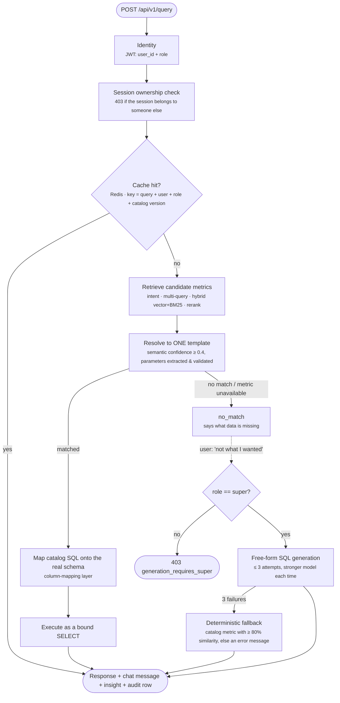
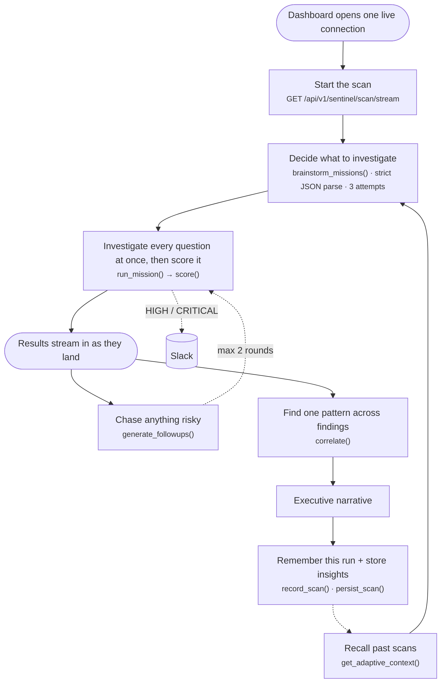
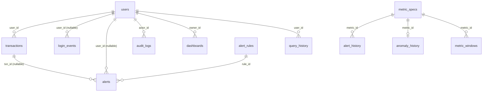

# 🦅 InsightOS: The Virtual CIO for Real-Time Financial Intelligence

[]()
[]()
[]()

> **InsightOS** turns natural-language questions into executive-level business intelligence. Answers come from a
> **catalog of vetted, parameterized metrics first**; free-form SQL generation is a guarded last resort. Every answer is
> cached, user-isolated, audited, and measured by an evaluation framework.

**Contents:** [Architecture](#-architecture) · [Data modelling](#-data-modelling) · [Evaluation](#-evaluation) ·
[Guardrails](#-guardrails) · [Getting started & how to run](#-getting-started--how-to-run-each-part) ·
[API reference](#-api-reference-important-endpoints-by-importance) · [Known limitations](#-known-limitations)

---

## 🏗️ Architecture

InsightOS is two products sharing one engine. **Query** answers one question a person just typed. **Sentinel** invents
its own audit questions and runs them in bulk. Both use the same reliability stack (retries, fallback, strict parsing,
audit); Query adds the catalog-first answer path and caching.

### 1. Query: catalog-first, generation only as a guarded last resort



1. **Identity & isolation first.** The caller's `user_id` and `role` come from a JWT. A session id owned by another user is
   rejected before any work happens. The cache key includes user, role and catalog version, so users never share answers.
2. **Parameterized first.** `app/modules/preprocessing/service.py` finds the best metrics for the question: a small
   model classifies intent/complexity, complex questions are split into sub-queries, vector search and BM25 are fused,
   and the shortlist is re-ranked (retrieval score, similarity to a pre-computed answer, and a gentle boost for vital
   tables). `app/modules/param_resolver.py` then picks one template and extracts its parameters (`last 30 days`,
   `top 5`, `over 50k`, enum values). Nothing is generated by an LLM on this path.
3. **The catalog is mapped onto the real database.** Catalog SQL is written once against the canonical schema.
   `app/core/schema_mapping.py` rewrites it for the connected database (renamed columns, text timestamps, integer flags,
   enum spellings). Metrics the database cannot support are filtered out up front, and if the *best* match is one of
   them the reply names the missing data instead of answering a weaker question.
4. **Generation is gated.** Free-form SQL is only produced when the user says they are dissatisfied **and** their role is
   `super`. It runs through `generate → validate → execute` as one attempt, retried up to 3 times with a stronger model
   (`gemini-2.5-flash-lite` → `gemini-2.5-flash` → `gemini-2.5-pro`), then the deterministic fallback.
5. **Everything is recorded.** Each turn is stored in the user's session (server-side history is authoritative),
   insights are stored with timestamps, and an audit row (SQL hashed, never raw) goes to a separate audit database.

The underlying LangGraph pipeline (`app/orchestration/workflow.py`) is:
`classify_intent → (clarification | guidance | generate_sql) → present → (visualization ‖ insight) → format_response`.

### 2. Sentinel: autonomous scan, rated by humans

The dashboard opens one live connection (SSE). The server decides what to investigate, runs every question concurrently
through the same pipeline, scores risk from the data, chases risky findings (max 2 rounds), correlates shared entities,
writes an executive narrative, and remembers the run to shape the next one. HIGH/CRITICAL findings go to Slack in the
background.



**Human-in-the-loop.** Each stored insight can be rated 👍/👎 by its owner. A 👎 opens a **human-review chat thread**
(reviewers with role `admin`/`super` reply in it) and notifies reviewers. When one user's false ratings exceed **3**
(exactly 3 does not flag), an anomaly flag is raised once, a backend alert is emitted, and the **Insight Anomaly
Detection** button on the Sentinel dashboard turns red. Scan history is owner-only.

### 3. Alerts & dashboards (secondary)

`POST /api/v1/alert` turns "tell me when…" into a precise metric rule (what to count, filter, window, threshold); a
background engine (`AlertEngineService`) enforces saved rules on a rolling window and surfaces breaches as active
alerts. Chat answers can be saved as dashboard widgets via `POST /api/v1/dashboards`.

### Where things live

| Concern | Module |
| :--- | :--- |
| Query endpoint, session/insight/audit orchestration | `app/api/endpoints.py` (`handle_query`, `answer_query`) |
| Catalog-first resolution, generation gate | `app/modules/param_resolver.py` |
| Retrieval (intent, multi-query, hybrid, rerank, join compression) | `app/modules/retrieval/`, `app/modules/preprocessing/service.py` |
| Metric catalog & schema profiling | `app/modules/catalog/` |
| Column mapping (canonical → physical schema) | `app/core/schema_mapping.py`, `app/data/schema_mappings.json` |
| LLM pipeline, retries, fallback, strict parsing | `app/orchestration/workflow.py`, `app/services/{llm,retry_policy,deterministic_fallback,backend_alerts}.py` |
| Cache, vectors, embeddings | `app/services/{cache,vector_store,embeddings}.py` |
| Identity | `app/core/auth.py` |
| Sessions, insights, audit, human handoff | `app/services/{session_store,insight_store,audit_db,human_handoff}.py` |
| Sentinel | `app/orchestration/sentinel_agent.py`, `app/api/sentinel.py` |
| Evaluation | `app/eval/`, `app/api/eval_endpoints.py`, `tests/eval/` |
| Frontend (React + Vite) | `frontend-react/src/components/` |

---

## 🗄️ Data modelling

### Business data (canonical schema: `app/files/derivinsight_schema.sql`, `app/files/alerts_schema.sql`)



| Table | Role | Indexed columns (all single-column unless noted) |
| :--- | :--- | :--- |
| `transactions` | main fact table | user_id, status, txn_type, amount_usd, created_at, instrument, **(user_id, created_at)** |
| `users` | join hub / dimension | country, kyc_status, risk_level, account_status, created_at |
| `alerts` | detection output | user_id, severity, status, rule_name, created_at |
| `login_events` | security facts | user_id, status, ip_address, country, created_at |
| `audit_logs` | business audit trail | actor_id, action, created_at |
| `alert_rules`, `dashboards`, `query_history` | config / app metadata | owner_id, is_deployed (dashboards) |
| `events`, `metric_specs`, `alert_history`, `anomaly_history`, `metric_windows` | alert-engine internals | table_name, created_at, (table_name, created_at), metric_id, (metric_id, event_timestamp) … |
| views `v_flagged_transactions`, `v_open_alerts`, `v_daily_summary`, `v_high_risk_users` | pre-joined read paths | — |

Table **weights** used for reranking (`app/data/table_weights.json`): transactions 1.0 · alerts 0.95 · users 0.9 ·
login_events 0.8 · the four views 0.75 · engine tables 0.35–0.5 · dashboards/query_history 0.25.

### Physical databases can differ: the column-mapping layer

The bundled `derivinsightnew.db` is **not** the canonical shape: `users.username` instead of `full_name`, no
`email`/`country`, only three tables, an `INTEGER` `is_pep`, `Desktop` instead of `DESKTOP`, and timestamps in three text
formats (`2023-01-15T09:30:00Z`, `3/31/24 6:07`, `2024-04-18 21:53:35`). `app/core/schema_mapping.py` detects the shape
(profiles in `app/data/schema_mappings.json`), rewrites catalog SQL with `sqlglot`, and reports which metrics are
**unavailable** (with the reason) when a table or column is missing, instead of guessing. On the bundled database, 43 of
83 metrics are *runnable*. **Runnable is not the same as correct:** the mapping does not yet reconcile differing
**enum vocabularies** (see [Known limitations](#-known-limitations)), so a few "available" enum-parameter metrics return
zero or incomplete results on that database.

### Metric catalog (`app/data/metric_catalog.json`, 83 metrics)

Generated from the schema by `app/modules/catalog/` (curated cross-table templates plus per-column distributions,
filtered counts and daily trends). Each metric carries: `sql` (named binds, SELECT only, portable across SQLite/Postgres),
`parameters` (typed, bounded), `tables`/`joins`/`columns`, `interpretation` and `direction`
(`higher_is_worse|better|neutral`), `domain`, `example_queries`, and **`indexed` / `fast` / `access`** derived from
`EXPLAIN` (`seek`, `index_scan`, `full_scan`). Every metric is executed in an in-memory sandbox during generation.

### Stores owned by the application

| Store | Contents | Default (dev) → production |
| :--- | :--- | :--- |
| Business DB | the tables above | `DATABASE_URL` (SQLite file → PostgreSQL) |
| `nl2sql_meta` | `vector_documents` (pgvector, HNSW cosine, 384-dim), `chat_sessions`, `chat_messages`, `insights`, `insight_ratings`, `insight_anomaly_flags`, `scan_owners`, `handoff_threads`, `handoff_messages`, `eval_runs`, `eval_items` | local SQLite files → one PostgreSQL database (`META_DATABASE_URL`, `SESSION_DATABASE_URL`, `EVAL_DATABASE_URL`) |
| `nl2sql_audit` | `audit_events` (SQL stored as sha256, never raw) | `AUDIT_DATABASE_URL`, a **separate** database |
| Redis | prompt → result cache, TTL 900 s, single-flight | `REDIS_URL` (degrades gracefully if down) |

**Vector metadata** on every row: `user_id` (None = global catalog), `session_id`, `level`
(`table|column|value|metric|template`), `table`, `indexed`, `joins`, `fast`, `interpretation`, `created_at`. Every search
filters on `user_id`; a search without one sees global catalog documents only.

---

## 📈 Evaluation

A regression framework measures retrieval and generation so quality changes are visible.

| Piece | What it does |
| :--- | :--- |
| **Golden dataset** `app/data/golden_dataset.json` | 290 questions generated from the catalog: paraphrases, typos, abbreviations, time windows and multi-metric questions (225 simple, 24 join, 41 complex). Expected SQL and expected rows come from a seeded in-memory sandbox with production-like skew. Deterministic per seed. |
| **Retrieval metrics** | precision@k, recall@k, MRR, hit-rate |
| **Generation metrics** | execution accuracy (order-insensitive row match), **faithfulness** (are the numbers in the answer grounded in the rows), **relevancy** (embedding similarity of question and answer); an optional LLM judge parses strictly in one shot |
| **Regression gate** | a run is `regressed` if precision, recall, faithfulness or relevancy drops by more than `EVAL_MAX_DROP` (0.05) versus the latest non-regressed run; `tests/eval` also enforces committed floors in `app/data/eval_baseline.json` |
| **Dashboard** | Eval view in the frontend: 4 metric time series, run table, "Run evaluation" button |

Measured on the golden set with the real embedding model (vector-only baseline → full pipeline): recall@5 0.931 → 0.993,
MRR 0.875 → 0.954. **Treat these as ceilings:** golden questions are derived from catalog wording, so they flatter
retrieval. See [Known limitations](#-known-limitations).

---

## 🛡️ Guardrails

| Risk | Guardrail |
| :--- | :--- |
| Generated SQL modifies data | `assert_select_only` parses the full SQL tree (not just the root): rejects INSERT/UPDATE/DELETE/DDL, writable CTEs, `SELECT INTO`, locking clauses and side-effect functions (`pg_sleep`, `lo_import`, `set_config`, …). Enforced in the validator, again before execution, and again in the endpoint. Catalog templates are also bound-parameter only. |
| Free-form generation by anyone | Only when the user is dissatisfied **and** `role == "super"`; otherwise HTTP 403 `generation_requires_super`. A parameterized attempt always comes first. |
| Cross-user data leakage | Per-user sessions (foreign session → 403), user-scoped vector search, user in the cache key, owner-only insights/ratings/scan history, user filter on every vector query. |
| Forged identity | JWT HS256 with required `exp`/`sub`, role re-read on every request, **no default secret**; header identity exists for dev only and is off by default. |
| Runaway LLM cost / loops | Hard cap of 3 attempts (a stronger model on attempts 2–3), one retry layer only, provider calls kept off the event loop. |
| LLM returns junk | Output is parsed **once** (single JSON object, optional ```json fence); failure raises and emits a **backend alert** (log + Slack, throttled). No repair loops. |
| Everything fails | Deterministic fallback: run a catalog metric only if it matches the question with ≥ 80% semantic similarity (exactly 0.80 passes); otherwise return an error message. |
| Answering the wrong question | Match confidence threshold; unavailable metrics are never substituted for the real best match. |
| Untraceable actions | Every request, denial and failure is audited asynchronously to a separate database; SQL is stored only as a hash; tokens, rows and secrets are stripped from audit detail. |
| Bad insights go unnoticed | 👎 ratings open a human-review thread; more than 3 false ratings flags an anomaly. |
| Cache serving stale answers | Key includes the catalog version; "not what I wanted" bypasses the cache. |

Remember to also run generated SQL under a **SELECT-only database role** in production; the guard above is a denylist.

---

## 🚀 Getting started & how to run each part

**Requirements:** Python 3.10+ (Docker image uses 3.11), Node 18+ (tested on 20), optional Redis, optional PostgreSQL
17/18 with pgvector.

### 1. Install and configure
```bash
python -m venv venv && source venv/bin/activate        # Windows: .\venv\Scripts\activate
pip install -r requirements.txt
cd frontend-react && npm install && cd ..
```

Create `.env` (never commit it). Only `GEMINI_API_KEY` is required to start:

| Variable | Default | Purpose |
| :--- | :--- | :--- |
| `GEMINI_API_KEY` | – | LLM access (required) |
| `DATABASE_URL` | `sqlite:///./derivinsightnew.db` | business database (SQLite or PostgreSQL) |
| `JWT_SECRET`, `AUTH_REQUIRED` | unset / `false` | set the secret and `AUTH_REQUIRED=true` in any shared environment; otherwise all callers are one shared "anonymous" user |
| `VECTOR_BACKEND`, `META_DATABASE_URL` | `memory` / local Postgres URL | `VECTOR_BACKEND=pgvector` uses PostgreSQL + pgvector |
| `SESSION_DATABASE_URL`, `AUDIT_DATABASE_URL`, `EVAL_DATABASE_URL` | local SQLite files | sessions/insights, audit, eval results |
| `REDIS_URL` (and `REDIS_HOST=`) | AWS Valkey host | **the default `REDIS_HOST` points at a specific cloud host: set `REDIS_HOST=` (empty) and `REDIS_URL=redis://localhost:6379/0` for local Redis.** Without Redis everything still works, uncached. |
| `SQL_MODEL`, `INTENT_MODEL`, `RETRY_MODEL`, `FINAL_RETRY_MODEL` | flash-lite / flash-lite / flash / pro | model ladder |
| `EMBEDDING_BACKEND` | `sentence-transformers` | `hash` = offline, lexical, for tests only |
| `SLACK_BOT_TOKEN`, `SLACK_CHANNEL`, `BACKEND_ALERT_CHANNEL` | unset | Slack alerts |
| `ANOMALY_THRESHOLD`, `PARAM_MATCH_THRESHOLD`, `FALLBACK_MIN_SIMILARITY` | `3` / `0.4` / `0.8` | tuning |

### 2. Run the API and the UI
```bash
python -m uvicorn app.main:app --reload --port 8080     # API  → http://localhost:8080
cd frontend-react && npm run dev                        # UI   → http://localhost:5173
```
The UI has three views: **Sentinel** (default), **Query chat** (`👎 Not what I wanted` re-asks with `dissatisfied=true`),
and **Eval**. It reads a JWT from `localStorage["auth_token"]` if present.

### 3. Get a token (authenticated use)
```bash
export JWT_SECRET=change-me
python -c "from app.core.auth import create_token; print(create_token('alice', 'super'))"   # roles: user | super | admin
curl -H "Authorization: Bearer <token>" localhost:8080/api/v1/eval/runs
```

### 4. Ask a question
```bash
curl -s localhost:8080/api/v1/query -H 'Content-Type: application/json' \
  -d '{"query": "how many flagged transactions in the last 3650 days"}'
# → {"status":"success","source":"parameterized","metric_id":"flagged_txn_count","cache_hit":false,"results":[{"flagged_count":75}], ...}

# not satisfied? (needs a token with role "super", otherwise 403 generation_requires_super)
curl -s localhost:8080/api/v1/query -H "Authorization: Bearer <super-token>" -H 'Content-Type: application/json' \
  -d '{"query": "...", "dissatisfied": true, "session_id": "<from the first response>"}'
```
Verified on the bundled database: flagged transactions → 75, failed logins → 50, PEP users → 20, and "open alerts by
severity" → `no_match` with *"table 'alerts' does not exist"*.

### 5. Metric catalog and golden dataset
```bash
python -m app.modules.catalog.metric_generator          # regenerate app/data/metric_catalog.json (executes every metric)
python -m app.eval.golden_builder                       # regenerate app/data/golden_dataset.json
python -m app.core.schema_mapping --db "sqlite:///file:$PWD/derivinsightnew.db?mode=ro&uri=true" --execute
#   → which metrics run on this database (read-only), and whether each executes
```

### 6. Evaluation
```bash
pytest tests/eval                                       # regression suite: persists a run, fails on a drop or below the floors
UPDATE_EVAL_BASELINE=1 pytest tests/eval               # accept an intentional change (rewrites app/data/eval_baseline.json)
curl -X POST "localhost:8080/api/v1/eval/run?label=nightly"   # same, via the API (results appear on the Eval view)
```

### 7. Tests
```bash
pytest -q                                               # offline suite (fakes for LLM/Redis; hash embedder)
NL2SQL_TEST_PG=postgresql+psycopg2://localhost:5432 pytest tests/integration   # live PostgreSQL + pgvector
```
The integration tests need a Postgres user that can create databases and the `vector` extension; each test uses a
throwaway database.

### 8. PostgreSQL + pgvector + migration
```bash
brew install pgvector                                   # for Postgres 17/18 (not 14); then CREATE EXTENSION vector
createdb derivinsight && createdb nl2sql_meta
python -m app.files.migrate_to_postgres --source sqlite:///./derivinsightnew.db \
       --target postgresql+psycopg2://localhost:5432/derivinsight
#   legacy shapes are mirrored 1:1 (nothing invented), text timestamps become real TIMESTAMPs, then verified
export DATABASE_URL=postgresql+psycopg2://localhost:5432/derivinsight
export VECTOR_BACKEND=pgvector META_DATABASE_URL=postgresql+psycopg2://localhost:5432/nl2sql_meta
```
`--target-schema canonical` is refused for a legacy source (it would need data the source does not have).

### 9. Docker
`docker build -t insightos .` builds the API image (Python 3.11). Pass the same environment variables.

---

## 📚 API reference (important endpoints, by importance)

All paths are under `http://localhost:8080`. `Auth` = JWT bearer token; calls without one run as the shared
`anonymous` user unless `AUTH_REQUIRED=true`.

| # | Method & path | Purpose | Auth / notes |
| :-: | :--- | :--- | :--- |
| 1 | `POST /api/v1/query` | Ask a question. Body: `query`, `domain`, `session_id`, `dissatisfied`. Returns `status` (`success`, `no_match`, `needs_clarification`, `failed`), `source` (`parameterized`/`generated`), `metric_id`, `cache_hit`, `session_id`, `results`, `insight`. | `dissatisfied=true` needs role `super` (403 otherwise); foreign `session_id` → 403 |
| 2 | `GET /api/v1/sentinel/scan/stream` | Live autonomous scan (Server-Sent Events: missions, logs, deep dives, correlation, narrative, `insights_saved`). | Scan and insights are owned by the caller |
| 3 | `GET /api/v1/sentinel/scan` | Same scan, returned at once. | as above |
| 4 | `POST /api/v1/sentinel/insights/{insight_id}/rating` | Rate an insight `{"rating": true|false}`. `false` opens a human-review thread and may raise the anomaly flag. | owner only (404 otherwise) |
| 5 | `GET /api/v1/sentinel/insights/anomaly`<br>`POST /api/v1/sentinel/insights/anomaly/detect` | Anomaly status; the "Insight Anomaly Detection" button (flags once when false ratings > 3). | per user |
| 6 | `GET /api/v1/sentinel/handoff/threads`<br>`GET …/threads/{thread_id}`<br>`POST …/threads/{thread_id}/messages` | Human-review chat. Reviewers (`admin`/`super`) see all open threads and reply as `human`. | owner or reviewer |
| 7 | `GET /api/v1/sentinel/history`<br>`GET /api/v1/sentinel/history/{scan_id}` | Past scans. | owner only |
| 8 | `GET /api/v1/eval/metrics`<br>`GET /api/v1/eval/runs`, `GET …/runs/{run_id}`<br>`POST /api/v1/eval/run` | Eval dashboard data (precision, recall, faithfulness, relevancy over runs); trigger a run. | currently unauthenticated (see limitations) |
| 9 | `POST /api/v1/alert` | Natural language → alert metric rule. | |
| 10 | `POST /api/v1/alerts/metrics`, `GET /api/v1/alerts/metrics`, `GET/PUT/DELETE /api/v1/alerts/metrics/{metric_id}` | Manage saved alert rules. | |
| 11 | `GET /api/v1/alerts/active`, `GET /api/v1/alerts/history`, `GET /api/v1/alerts/stats` | Active alerts, history, summary. | |
| 12 | `POST /api/v1/dashboards`, `GET /api/v1/dashboards`, `GET /api/v1/dashboards/{dashboardId}` | Save and load dashboards. | |
| 13 | `GET /health` | Liveness probe. | |

Operational and diagnostic routes also exist (`/api/db-test/*`, `/redis-test/*`, alert-engine and event-generator
start/stop, `/api/v1/alerts/redis/*`). They are not part of the product surface and are deliberately not documented here;
do not expose them publicly.

---

## ⚠️ Known limitations

Tracked in `ISSUES.md`; the ones that matter when deploying:

- **Enum vocabularies on the bundled database (ISS-106).** Its values differ from the catalog's: `payment_method` is
  `Credit Card`/`Wire Transfer`/… (catalog: `CARD`, `BANK_TRANSFER`, …), transactions have `CANCELLED`/`REFUND` (catalog:
  `REVERSED`/`BONUS`), users have a `CRITICAL` risk level the catalog does not know, and `failure_reason` is free text.
  Affected: the `*_payment_method_count`, `*_status_count`, `*_txn_type_count`, `*_failure_reason_count`,
  `users_risk_level_count` and the four `high_risk_*` metrics (they silently exclude `CRITICAL`); empty-string values are
  also treated as real values (ISS-107). Metrics that group by a column (`*_by_status`, …) report the real values and are fine.
- **Secrets hygiene.** `.env.example` is tracked and currently contains a real-looking database credential (ISS-93):
  rotate it and keep placeholders only. Start-up also logs the full `DATABASE_URL` for non-SQLite databases (ISS-94), so
  avoid password-bearing URLs until that is fixed. The default `REDIS_HOST` is a concrete cloud host (ISS-103).
- **Auth is opt-in.** Set `JWT_SECRET` and `AUTH_REQUIRED=true`; the `/eval` and `/alert` families are not yet behind identity.
- **Result scoping:** catalog templates are global. Isolation is enforced for sessions, insights, ratings, scans, audit and the
  cache, but not yet at the row level of business data (needs an ownership model for business tables).
- **Eval numbers are optimistic** (golden questions reuse catalog wording; expected rows come from synthetic data) and the
  committed floors are tied to the offline hash embedder. Re-baseline with real data.
- **Sentinel** has the retry/fallback/parsing/audit stack, but not the catalog-first path, caching, or the `super` gate.
- Free-form SQL safety is a denylist plus the AST check: use a read-only database role.
- Other LLM callers (insights, visualization, entity extraction, …) still parse JSON ad hoc and do not raise backend alerts.

---

Developed for the **Deriv Hackathon** – *Empowering Executives with Data-First Decisioning.*
